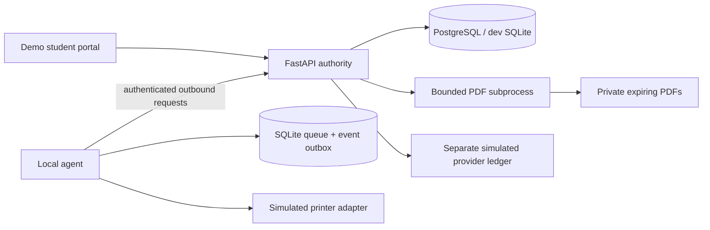

# Architecture and safety boundaries

The API is the authority for station identity, session ownership, PDF page count, price, quote expiry, payment verification and queue state. The demo browser owns no trusted financial state. Station codes are resolved server-side; bearer session tokens are random and stored as hashes. Students access only their documents, quotes and jobs. Agent credentials are bound to one configured station. The Phase 1 admin API uses a separate development key.

The SQLAlchemy schema supports PostgreSQL (Compose deployment) and SQLite (native smoke testing). Alembic owns schema creation; importing the API never creates tables. All entity identifiers are UUID strings. UTC timestamps use integer epoch seconds, with amounts in integer UGX. Quote settings, rate and price version are snapshotted. Database foreign keys and unique constraints guard quote→job, provider references, events and print attempts. Updates use optimistic compare-and-swap versions under a database transaction to serialize competing payment/claim operations. Conflicts return 409 and are safe to retry.

## Payment boundary

Initiation snapshots the quote amount and creates a unique merchant reference. A pending attempt is reused, preventing repeated button presses from creating new charges. A verified failure permits a distinct retry. Before initiation the API requires fresh printer readiness, supported settings, an active station and a non-expired document/quote. Large orders (100+ sides) with unknown supplies are blocked. These tiers are proposals: 29 B/W sides cost 7,250; 30 cost 6,000. This non-monotonic decrease is intentional and needs business approval.

Admin-only simulated settlement changes the mock provider ledger, not the job. HMAC-authenticated webhooks are only signals to independently read that ledger. Reconciliation validates amount, UGX currency, provider, provider reference and merchant reference. A forged success claim, a pending provider transaction or mismatch cannot release printing. Replayed terminal callbacks are idempotent. Real-provider signatures and network verification are not implemented or implied.

## Dispatch and recovery

Agent polling atomically changes PAID to QUEUED with a 120-second claim lease and one audited attempt. Both backend and local adapter recheck readiness before dispatch. The agent verifies the PDF SHA-256 and persists a local dispatch intent before submit. Generated output uses exclusive file creation and cannot overwrite an existing job output. Duplex odd-page copies get blank separators; these are not billable.

A crash between any uncertain dispatch steps does **not** recycle the claim: agent startup reports COMPLETION_UNCERTAIN; the server also quarantines expired claims when polled. Terminal completion events are persisted with stable IDs in SQLite before delivery. Lost event acknowledgments replay safely. There is no claim of exactly-once physical printing across a network/printer boundary; ambiguous physical side effects need operator review. COMPLETED is labeled SIMULATED_OUTPUT_ONLY throughout this build.

One agent process owns each local database via an OS file lock. A local database can survive an API outage, but this version cannot claim new jobs offline. A job already claimed with a durable terminal event can synchronize afterward. Full local authority, prepaid credit, cloud outbox conflict handling and local Wi-Fi routing are Phase 4. No new Mobile Money payment is authorized offline.

## Documents and privacy

Uploads are limited to 20 MiB, PDF magic/type checked and renamed to UUIDs. Parsing occurs in a subprocess with a 20-second timeout; Linux additionally sets address-space, CPU and output-file limits. Compose adds non-root execution, no capabilities and container memory/CPU limits. Interactive/annotated, encrypted, embedded or corrupt PDFs are rejected conservatively. Normalized content is private and served only through authorized routes. DOCX stays disabled, with an actionable 415 response.

The parser process is not yet a full adversarial-document sandbox: it has the service account's file permissions and networking. Windows lacks the Linux child resource limits. Before accepting public uploads, isolate parsing in a separate no-network container with a read-only filesystem, per-job mounts, stronger syscall restrictions, a patched parser/rendering stack and abuse testing. The current single-process IP rate limiter is a demo safeguard, not a distributed quota service.

Retention runs every 30 seconds, deletes completed documents approximately 60 seconds after completion and deletes other document content at 24 hours. Expired access is rejected even before the sweep. A crash can leave an orphan upload, so the sweep also removes old untracked PDF/upload files. Simulated spool files expire after completion or, for uncertain outputs, within 24 hours. Run retention and agent cleanup services to enforce on-disk deletion. Persist only transaction metadata in backups; production filesystem/storage ACLs and encryption are an operator deployment requirement.

## State mapping

Document validation happens before quote creation; DRAFT/VALIDATING/QUOTED are resource lifecycle stages rather than persisted print-job rows. Persisted print jobs begin at AWAITING_PAYMENT. The domain module enforces allowed transitions; simulation API supports payment, claim, printing, completion, failure, pause and uncertainty. Production cancellation, reversal, refunds and approved reprint transitions remain disabled. A paused/uncertain job cannot be silently resubmitted.
